

  

 


<table><tr><td valign="middle" width="58%">

Hey, I'm <b>Rahul</b>, a CSE student who builds apps, websites and the systems behind them. I enjoy the whole stack: designing APIs, modelling data, setting up servers, and shipping interfaces people actually like using.

Right now I'm focused on software that's fast, reliable and simple to maintain. Most of that work still happens after midnight.

</td><td valign="middle" width="42%">

<b>Favorite game</b>

</td></tr></table>


  


  


<b>LANGUAGES</b> 

<b>FRONTEND</b> 

<b>BACKEND &amp; DATA</b> 

<b>MOBILE</b> 

<b>SHIP &amp; TOOLS</b> 

<b>GAME DEV (ON THE SIDE)</b> 


  


  


  

  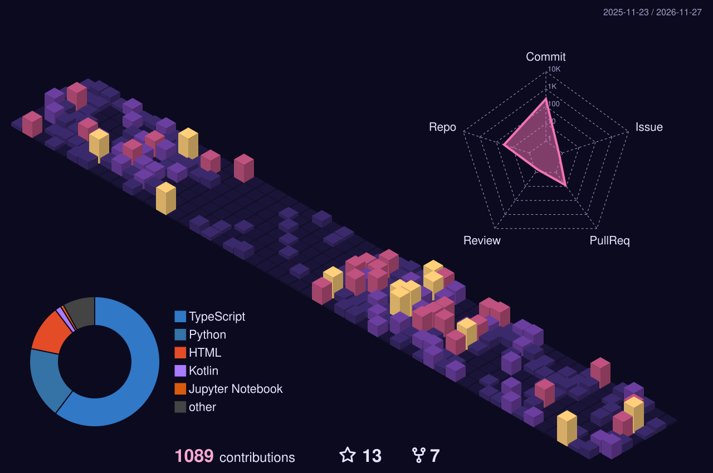

  
  

 

  
   
  

<!-- SVGs in /assets are generated by assets/generate.py — edit the text there and re-run -->
